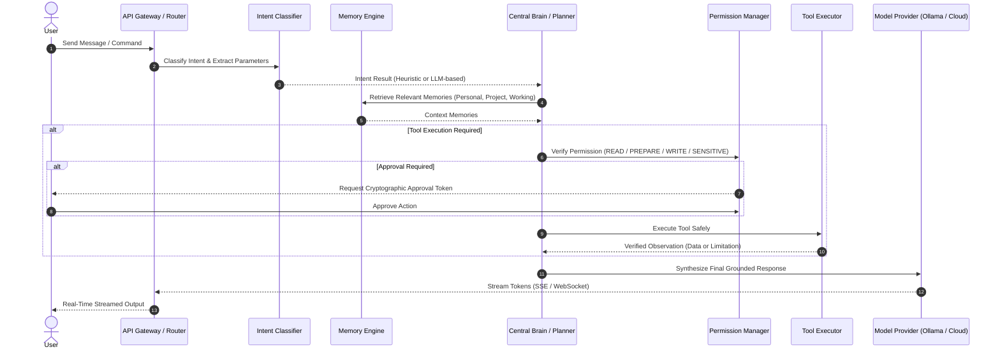

# NOUS — TARGET SYSTEM ARCHITECTURE BLUEPRINT

> **"Your Intelligence. Your Memory. Your Assistant."**  
> Complete Architectural Blueprint for the NOUS Personal AI Operating System.

---

## 1. System Overview & Architectural Tenets

NOUS is designed as a centralized Personal AI Operating System (AI-OS) centered around one **Unified AI Brain** and a **Shared Memory Substrate**. Unlike fragmented assistants that treat chat, daily planning, coding, and market research as disconnected tools, NOUS routes every user intent, tool action, and background automation through a central orchestrator.

```
                              +---------------------------------------+
                              |         MULTI-DEVICE CLIENTS          |
                              |  Web Browser  |  Phone  |  Laptop UI  |
                              +-------------------+-------------------+
                                                  |  HTTPS / WSS (JWT Auth)
                                                  v
+---------------------------------------------------------------------------------------------------+
|                                  NOUS CENTRAL ORCHESTRATION ENGINE                                |
+---------------------------------------------------------------------------------------------------+
|                                                                                                   |
|  +---------------------------+   +----------------------------+   +----------------------------+  |
|  |     AUTHENTICATION        |   |    CONTEXT BUILDER         |   |    SENSITIVE DATA VAULT    |  |
|  |  JWT / OAuth2 / Sessions  |   |  Dynamic Prompt / Budget   |   |   PII Masking & Redactor   |  |
|  +---------------------------+   +----------------------------+   +----------------------------+  |
|                                                |                                                  |
|                                                v                                                  |
|  +---------------------------------------------------------------------------------------------+  |
|  |                                  CENTRAL AI BRAIN                                           |  |
|  |  [ Intent Classifier ]  --->  [ Reasoning & Planner ]  --->  [ Tool / Agent Selector ]     |  |
|  +---------------------------------------------+-----------------------------------------------+  |
|                                                |                                                  |
|                  +-----------------------------+-----------------------------+                    |
|                  |                                                           |                    |
|                  v                                                           v                    |
|  +-----------------------------------------------+       +-------------------------------------+  |
|  |             MODEL ROUTER                      |       |        SPECIALIZED AGENTS           |  |
|  |  - Local Ollama Engine (qwen2.5:3b)           |       |  - Research Agent                   |  |
|  |  - Cloud APIs (OpenAI / Groq / OpenRouter)    |       |  - Coding Agent                     |  |
|  |  - Desktop Companion Outbound Tunnel          |       |  - Productivity Agent               |  |
|  |  - Streaming Generator (SSE / WebSocket)      |       |  - Market Intelligence Agent        |  |
|  +-----------------------------------------------+       |  - File & Document Agent            |  |
|                                                          +------------------+------------------+  |
|                                                                             |                     |
|                                                +----------------------------+                     |
|                                                v                                                  |
|  +---------------------------------------------------------------------------------------------+  |
|  |                              SAFE TOOL EXECUTION FRAMEWORK                                  |  |
|  |  [ Tool Registry ]  <--->  [ Permission Manager (READ/PREPARE/WRITE/EXTERNAL/SENSITIVE) ]    |  |
|  |  [ Execution Logger ] <---> [ User Approval Workflow (Cryptographic Tokens) ]               |  |
|  +---------------------------------------------------------------------------------------------+  |
+------------------------------------------------+--------------------------------------------------+
                                                 |
                                                 v
+---------------------------------------------------------------------------------------------------+
|                                   UNIFIED DATA & MEMORY LAYER                                     |
+---------------------------------------------------------------------------------------------------+
|  1. Working Memory (Active tasks & context)        4. Knowledge Memory (Notes & research papers)  |
|  2. Personal Memory (User profile & preferences)   5. Episodic Memory (Milestones & events)       |
|  3. Project Memory (Code decisions & milestones)   6. Storage Tier (SQLite WAL / PostgreSQL)      |
+---------------------------------------------------------------------------------------------------+
```

---

## 2. Layer-by-Layer Architectural Specifications

### 2.1 Presentation Layer (Frontend)
- **Technology:** HTML5, CSS3 Variables, Vanilla ES6+ JavaScript (Zero heavyweight framework overhead).
- **Design Philosophy:** Minimalist dark cyberpunk theme, high-contrast typography (`Inter` and `JetBrains Mono`), responsive CSS Grid/Flexbox layouts, off-canvas touch drawer for mobile.
- **Modules (12 Distinct Panels):**
  1. **Dashboard:** High-level executive overview (System status, active AI model, memory count, pending approvals, quick actions).
  2. **AI Chat:** Multi-turn conversation with streaming tokens, markdown rendering, tool call visualizers, and session history.
  3. **Memory Explorer:** Semantic memory viewer, category filter, manual fact adder, and privacy export/wipe controls.
  4. **Voice Assistant:** Hands-free voice interface with real-time waveform visualizer, interrupt-to-stop speech synthesis, and microphone sensitivity controls.
  5. **Daily Planner:** Routine builder, visual timeline, priority tasks, and automated daily review generator.
  6. **Projects & Coding:** Project dashboard, milestone tracker, GitHub repository commit/PR activity, and code review tools.
  7. **Research Workspace:** Multi-source web research engine, structured 8-part report generator, and persistent knowledge notebook.
  8. **Market Intelligence:** Real-time Indian and global stock ticker monitor, 20-factor causal reasoning, and institutional FII/DII flow tracker.
  9. **Files & Documents:** Safe sandboxed workspace file explorer, document reader, and PDF/code analyzer.
  10. **Automation Center:** Minute-to-minute daemon status, scheduled task manager, and offline activity monitor.
  11. **Settings:** AI model picker, API key management, voice rate/pitch parameters, and temperature calibration.
  12. **Security & Privacy:** Offline lockdown toggle, PII redaction rules, audit logs, and permission token manager.

---

### 2.2 Orchestration Layer (AI Core)

The AI Core coordinates every operation using a deterministic pipeline:



---

### 2.3 Memory Substrate (5-Tier Unified Memory)

NOUS structures memory into 5 distinct psychological and operational tiers:

```
+-------------------------------------------------------------------+
|                        5-TIER MEMORY TAXONOMY                     |
+-------------------+-----------------------------------------------+
| 1. WORKING        | Active conversation session, current task     |
|    MEMORY         | context, scratchpad, ephemeral variables.     |
+-------------------+-----------------------------------------------+
| 2. PERSONAL       | User identity, preferred name, learning       |
|    MEMORY         | goals, communication style, dietary habits.   |
+-------------------+-----------------------------------------------+
| 3. PROJECT        | Codebase architectures, tech stacks, active   |
|    MEMORY         | milestones, refactoring plans, decisions.     |
+-------------------+-----------------------------------------------+
| 4. KNOWLEDGE      | Extracted research papers, textbook notes,    |
|    MEMORY         | API documentation, verified technical facts.  |
+-------------------+-----------------------------------------------+
| 5. EPISODIC       | Historical timeline of major decisions,       |
|    MEMORY         | past achievements, previous system errors.    |
+-------------------+-----------------------------------------------+
```

#### Memory Pipeline:
- **Extraction:** Background extractor flags facts, user preferences, and decisions during conversation.
- **Privacy Check:** PII Redactor ensures passwords, tokens, and financial accounts are never committed to permanent memory.
- **Semantic Retrieval:** Combines BM25 keyword matching with local vector embeddings (via `sentence-transformers` or Ollama embeddings) for high-relevance recall without cloud dependency.

---

### 2.4 Tool & Agent Framework

All capabilities are encapsulated as structured tools with strict risk boundaries:

```
Permission Levels:
├── LEVEL 0: READ (Auto-approved)
│   ├── get_current_datetime, get_system_specs, calculate
│   ├── recall_memories, list_workspace_files, get_stock_quote
│   └── web_search, get_weather_forecast, lookup_dictionary
│
├── LEVEL 1: PREPARE (Auto-approved draft generation)
│   ├── draft_email_reply, generate_daily_review
│   └── prepare_code_refactor, draft_scheduled_task
│
├── LEVEL 2: WRITE (Requires confirmation)
│   ├── remember_fact, add_schedule_activity, update_activity_status
│   ├── write_workspace_file, add_project_milestone
│   └── save_research_note, set_market_alert
│
├── LEVEL 3: EXTERNAL ACTION (Explicit confirmation required)
│   ├── send_approved_email, github_push_commit
│   └── external_webhook_trigger
│
└── LEVEL 4: SENSITIVE ACTION (Strict cryptographic token confirmation)
    ├── execute_safe_command, delete_memory, purge_security_data
    └── offline_lockdown_toggle
```

---

### 2.5 Hybrid Compute & Desktop Companion Architecture

To satisfy the **zero-budget constraint** while delivering **24/7 cloud availability**:

```
+-----------------------------+                   +-----------------------------+
|    RENDER CLOUD SERVICE     |                   |  WINDOWS LAPTOP COMPANION   |
|  (24/7 Public Web Service)  |                   |   (Offline Local-First)     |
+-----------------------------+                   +-----------------------------+
| - FastAPI Web Server        |                   | - Ollama Engine (qwen2.5:3b)|
| - Responsive UI Hosting     |  Secure Outbound  | - Local Workspace & Files   |
| - Cloud Model Router        |<=================>| - Background Sync Worker    |
| - Minute-to-Minute Daemon   |  Encrypted Tunnel | - Hardware Telemetry Sensor |
| - External API Aggregator   |                   | - Speech Engine (Whisper)   |
+-----------------------------+                   +-----------------------------+
               |                                                 |
               v                                                 v
  When Laptop is Closed / Asleep                    When Laptop is Active / Open
  ------------------------------                    ----------------------------
  Cloud routes inference to free                    Cloud delegates inference to
  cloud models (Groq / OpenRouter /                 local Ollama (zero API cost,
  Gemini) or operates in static mode.               100% private execution).
```

---

## 3. Recommended Repository File Structure

```
nous/
├── backend/
│   ├── app/
│   │   ├── main.py                # FastAPI ASGI application factory
│   │   ├── config.py              # Environment configuration & defaults
│   │   │
│   │   ├── ai_core/               # Central Brain & Intelligence
│   │   │   ├── orchestrator.py    # Master coordinator (Process flow)
│   │   │   ├── intent.py          # Heuristic + LLM intent classifier
│   │   │   ├── context.py         # Context pruning & token budgeter
│   │   │   ├── planner.py         # Multi-step task decomposition
│   │   │   ├── router.py          # Hybrid local/cloud model routing
│   │   │   └── generator.py       # Streaming response generator
│   │   │
│   │   ├── providers/             # LLM & Embedding Model Adapters
│   │   │   ├── base.py            # Abstract Base Provider
│   │   │   ├── ollama.py          # Local Ollama adapter
│   │   │   └── cloud.py           # OpenAI/Groq/Gemini adapter
│   │   │
│   │   ├── memory/                # 5-Tier Memory Subsystem
│   │   │   ├── manager.py         # Memory lifecycle & retrieval
│   │   │   ├── extractor.py       # Conversational fact extractor
│   │   │   ├── retriever.py       # Hybrid semantic + BM25 search
│   │   │   └── schema.py          # Memory data models
│   │   │
│   │   ├── agents/                # Goal-Directed Specialized Agents
│   │   │   ├── base.py            # Agent abstract interface
│   │   │   ├── research.py        # Web Research & Paper Analyzer
│   │   │   ├── coding.py          # Repo Inspector & Code Generator
│   │   │   ├── productivity.py    # Routine, Calendar & Task Agent
│   │   │   ├── market.py          # Financial & Macro Reasoning
│   │   │   └── file_agent.py      # Workspace Document & File Agent
│   │   │
│   │   ├── tools/                 # Safe Tool Calling Framework
│   │   │   ├── registry.py        # Master tool registry & schemas
│   │   │   ├── permissions.py     # 5-tier permission gate
│   │   │   ├── approval.py        # Cryptographic approval tokens
│   │   │   └── logger.py          # Security execution audit logger
│   │   │
│   │   ├── security/              # Security Vault & Defense
│   │   │   ├── auth.py            # JWT token & user management
│   │   │   ├── redactor.py        # Zero-trust PII & secret scrubber
│   │   │   └── vault.py           # Security settings & audit store
│   │   │
│   │   ├── services/              # External Integrations
│   │   │   ├── public_apis.py     # Weather, Lexical, Currency, Jokes
│   │   │   ├── email_service.py   # Gmail OAuth & Sanitization
│   │   │   └── github_service.py  # GitHub REST API client
│   │   │
│   │   ├── automation/            # Autonomous Background Processing
│   │   │   └── daemon.py          # Minute-to-minute offline worker
│   │   │
│   │   └── api/                   # REST & WebSocket Endpoints
│   │       ├── auth_api.py        # Login / registration / tokens
│   │       ├── chat_api.py        # Chat & token streaming (SSE/WS)
│   │       ├── memory_api.py      # Memory inspection & CRUD
│   │       ├── agent_api.py       # Specialized agent dispatch
│   │       └── system_api.py      # Diagnostics & health checks
│   │
│   └── tests/                     # Automated Test Suites
│       ├── unit/                  # Fast component unit tests
│       ├── integration/           # Tool & database integration
│       └── e2e/                   # Full system pipeline verification
│
├── desktop/                       # Windows 11 Desktop Companion
│   ├── companion.py               # Outbound tunnel & hardware telemetry
│   └── install_companion.bat      # Windows autostart installer
│
├── frontend/                      # User Interface (Single Page App)
│   ├── index.html                 # 12-module UI layout
│   ├── css/style.css              # Cyberpunk dark responsive stylesheet
│   └── js/
│       ├── app.js                 # Central UI controller & router
│       ├── stream.js              # SSE/WebSocket streaming client
│       └── voice.js               # Audio synthesis & speech visualizer
│
├── data/                          # Persistent Local State
│   ├── nous.db                    # Unified SQLite database (WAL)
│   └── credentials/               # Protected OAuth tokens
│
└── deploy/                        # Deployment Configurations
    ├── Dockerfile                 # Multi-architecture container build
    ├── docker-compose.yml         # Container & volume orchestration
    └── render.yaml                # Render cloud deployment blueprint
```
